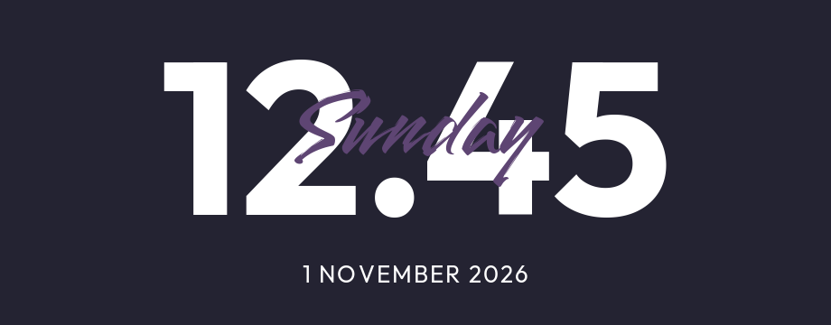

<div align="center">

# ClearClock

**A little typography for your desktop.**

A native [Noctalia](https://noctalia.dev) widget inspired by [qewer33/ClearClock](https://github.com/qewer33/ClearClock).



</div>

## Install

Requires **Noctalia v5.4.1+**, `curl`, and `tar`.

```sh
curl -fsSL https://raw.githubusercontent.com/Nirusaki-Malaal/clearclock-noctalia/main/install.sh | sh
```

Then open **Settings → Desktop → Add widget → ClearClock**. Turn off **Background** for the look above, and use the desktop editor to move and resize it.

Run the same command to update. The installer works without sudo, respects your Noctalia/XDG data directory, and keeps your settings.

<details>
<summary>Prefer to inspect the installer first?</summary>

```sh
curl -fsSLO https://raw.githubusercontent.com/Nirusaki-Malaal/clearclock-noctalia/main/install.sh
less install.sh
sh install.sh
```

Use `sh install.sh --no-enable` to install files without contacting the running shell.

</details>

## Make it yours

- **Time:** 12/24-hour format, optional seconds, and your choice of separator.
- **Typography:** bundled Outfit and Smooch fonts, custom fonts, sizes, and weights.
- **Color:** independent colors for the clock, weekday, and date.
- **Layout:** toggle the weekday or date, adjust spacing, then scale and position freely.
- **Time zone:** follow your system or choose an IANA zone such as `Asia/Kolkata`.

All options are available in the widget settings. Custom dates use Noctalia tokens, such as `%-d %B %Y` or `%Y-%m-%d`.

## More

[Configuration example](examples/clearclock.toml) · [Development & compatibility](docs/DEVELOPMENT.md) · [Installer](install.sh)

## Credits

Original design by **[qewer33](https://github.com/qewer33/ClearClock)**. Noctalia port by **[Nirusaki](https://github.com/Nirusaki-Malaal)**.

[GPL-3.0-or-later](LICENSE). Outfit and Smooch are bundled under the [SIL Open Font License](clearclock/fonts/Outfit-OFL.txt).
