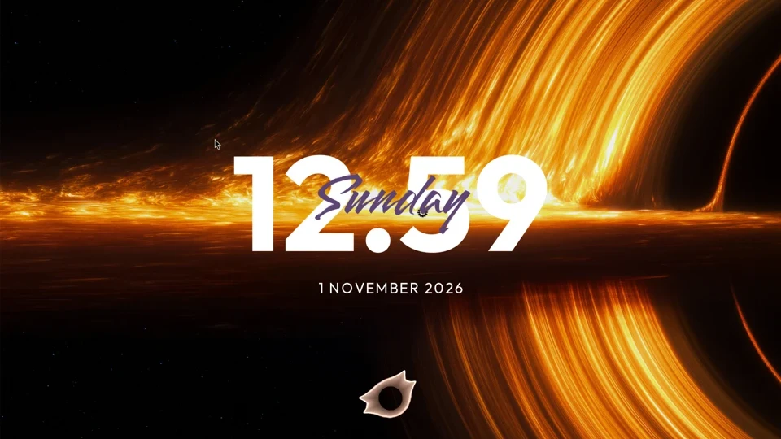

# ClearClock

A Noctalia v5.4.1+ desktop widget port of [qewer33/ClearClock](https://github.com/qewer33/ClearClock), with its original Outfit clock, Smooch weekday overlay, and spaced date.

Enable `nirusaki/clearclock`, then add **ClearClock** under **Settings → Desktop**. New saved instances default to a transparent background. Drag and scale it in the desktop editor.

**Wallpaper gradient** samples the wallpaper beneath the saved clock position and renders a smooth gradient through the digits. Saving a move, resize, rotation, or wallpaper change refreshes the local colors.

**Frosted glass font** puts a softened wallpaper fill and polished edges inside translucent clock digits. **Frosted background** adds a separate rounded blurred card. Both effects have independent strength controls and can be combined or used separately. Requires Python 3 and Pillow.

Disable the wallpaper gradient to use solid adaptive palette colors. Turn **Adaptive colors** off to use the three manual color controls. The glass effects also work with manual colors.

Background defaults only apply when no background choice is saved. Explicit enabled or disabled backgrounds are preserved, including after an update. Glass effects use the wallpaper image, not windows or live video behind the widget. Placement changes appear after saving the desktop editor.

Per-instance settings cover 12/24-hour time, seconds, separator, IANA time zone, weekday/date visibility, fonts, colors, sizes, bold weights, and date spacing. `ccdefault` selects the bundled fonts. Date patterns use Noctalia/strftime tokens (`%-d %B %Y`), rather than Qt patterns. Empty time zone follows system local time. Invalid zones fall back to local time.

Italic text and text shadows are not exposed by the current Noctalia label API. Date uppercase conversion covers ASCII; set letter spacing to zero to preserve shaping for complex scripts.

GPL-3.0-or-later, following the original ClearClock source. Bundled fonts are SIL OFL 1.1; notices are in `fonts/`.

