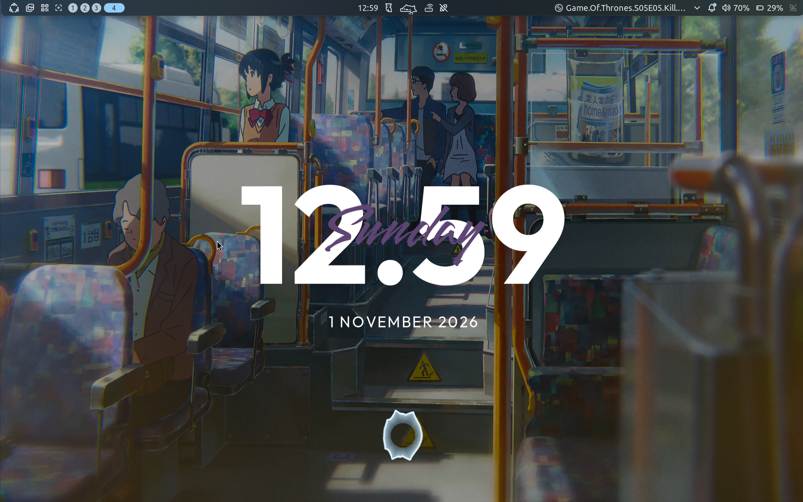
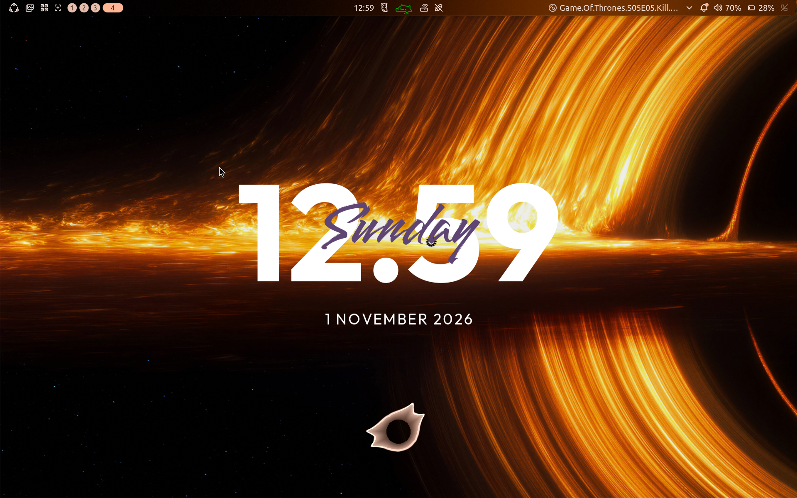

# ClearClock for Noctalia

A native desktop widget port of [qewer33/ClearClock](https://github.com/qewer33/ClearClock): a large Outfit clock, a Smooch weekday written across it, and an uppercase, letter-spaced date. No KDE, Qt, external clock process, or polling subprocess is needed.

Targets **Noctalia v5.4.1**, using Luau plugin API 26 for configuration reads and safe argument-array IPC. This is a desktop widget for the v5 shell.

## Install

From this repository's root:

```sh
plugin_dir="${NOCTALIA_DATA_HOME:-${XDG_DATA_HOME:-$HOME/.local/share}}/noctalia/plugins/clearclock"
mkdir -p "$plugin_dir"
cp -R clearclock/. "$plugin_dir/"
noctalia msg config-reload
noctalia msg plugins enable nirusaki/clearclock
```

If you set `NOCTALIA_DATA_HOME`, use `$NOCTALIA_DATA_HOME/noctalia/plugins` instead. For development, symlink `clearclock/` into that plugins directory; Luau edits hot-reload automatically. Reload the configuration after manifest edits.

Open **Settings → Desktop**, add **ClearClock**, and use the editor to position and resize it. Each saved instance defaults to transparent and has its own clock, weekday, and date settings.

For a declarative layout, merge [examples/clearclock.toml](../examples/clearclock.toml) into your configuration. Change the output connector to match your monitor. If your existing layout has `widget_order`, append `"clearclock"` to that list; entries absent from the list are ignored. GUI overrides in `settings.toml` take precedence over config files.

This repository also includes a source `catalog.toml` and the required `clearclock/` subdirectory, so it can be distributed as a Noctalia plugin source.





## Options

- 12/24-hour time, optional seconds, and a literal separator (including an empty separator).
- Independent clock, weekday, and date colors, font families, sizes, and bold weights.
- Adaptive colors are enabled by default. Semantic roles (`primary`, `on_primary`, `on_surface`) remain in the retained UI tree, so palette changes repaint live without waiting for the next clock tick. Disable adaptive colors to restore manual colors. These roles follow the active theme, including wallpaper-generated palettes; the widget does not sample local wallpaper brightness or guarantee contrast against every wallpaper pixel.
- Show/hide the weekday overlay and date; adjust date spacing and the gap below the clock.
- Date patterns use **strftime/Noctalia tokens**, e.g. `%-d %B %Y`, `%Y-%m-%d`, or `%A, %d %B`. Qt patterns such as `d MMMM yyyy` must be converted.
- Optional IANA time zone, e.g. `Asia/Kolkata` or `Europe/Berlin`; empty follows system local time. Invalid names follow Noctalia's documented local-time fallback.

`ccdefault` or an empty font family selects the bundled fonts. Native theme role colors such as `primary` and `on_surface` also work. The host owns widget placement, scale, rotation, opacity, and background controls. Minute-only clocks use the host's minute-boundary updates; showing seconds requests second-boundary updates. Every label is formatted from one shared timestamp.

Noctalia v5.4.1 hard-codes plugin backgrounds to enabled outside the script's UI tree. The `defaults` service checks saved desktop widget configuration every two seconds and supplies `background = false` only to ClearClock instances without an explicit value. It uses a leaf merge through argument-array IPC, preserves other settings and widget types, and backs off after errors. Changes are applied after saving the desktop editor. An explicit background choice is never overwritten. No background setting is declared in the plugin manifest because Noctalia owns that setting and does not honor a plugin-level override of its default.

The current declarative label API has no italic or text-shadow properties, so those Plasma-specific options are omitted. Date spacing is implemented as a row of UTF-8 codepoints; combining marks/complex-script shaping across characters are best preserved by setting spacing to zero. Uppercasing uses Luau's ASCII `string.upper`, so non-ASCII characters retain their case. The weekday/date names follow Noctalia's locale.

## Verify

Requires Python 3.11+, Lua 5.4, and Noctalia:

```sh
python3 tests/check.py
python3 tests/installer.py
```

This checks manifest/catalog consistency, translations, bundled font licenses, Noctalia settings lint, and the actual entry script's formatting and UI tree: midnight/noon, day rollover, separators, seconds, visibility, fonts, and UTF-8 dates.

The same command also verifies adaptive/manual color roles and the defaults service's preservation of explicit choices, quoted IDs, pending writes, and failure backoff. The 1.1.0 change was rendered in both light and dark palettes in an isolated Noctalia session; live checks verified transparent defaults and persistence of explicit backgrounds.

The installer harness uses temporary directories and mock downloads to verify fresh installs, upgrades, failed downloads, invalid archives, failed lint, activation, symlink protection, and Noctalia/XDG path handling. To fetch a particular revision, set `CLEARCLOCK_REF` when invoking the installer. The default tracks `main`.

The port was also rendered in an isolated nested Niri session running Noctalia v5.4.1, with separate configuration/data/state directories. The desktop screenshots above were supplied by the user. No changes to your main Noctalia configuration are required by these checks.

## References and attribution

Implementation follows the stable v5.4.1 documentation:

- [Manifest and settings](https://docs.noctalia.dev/noctalia/v5.4.1/plugins/development/manifest/)
- [Declarative UI and desktop widget ticks](https://docs.noctalia.dev/noctalia/v5.4.1/plugins/development/declarative-ui/)
- [Runtime API: fonts and time formatting](https://docs.noctalia.dev/noctalia/v5.4.1/plugins/development/runtime-api/)
- [Development and distribution workflow](https://docs.noctalia.dev/noctalia/v5.4.1/plugins/development/workflow/)
- [Desktop layout configuration](https://docs.noctalia.dev/noctalia/v5.4.1/desktop/widgets/)

Original composition, defaults, and bundled font files come from **qewer33/ClearClock**, revision `fd9e4795d24ab80c45846a634c3c844850674c51`, inspected on 2026-11-01. Its QML declares GPL-3.0-or-later; this port is distributed under the same license. See [LICENSE](../LICENSE).

Outfit is by the Outfit project authors and Smooch by the Smooch project authors. Both are distributed under the SIL Open Font License 1.1; the corresponding notices are included in `clearclock/fonts/`.
